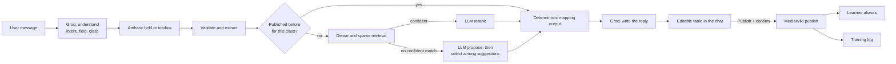

# agentic-amdbpedia

An AI-assisted workflow for mapping Amharic Wikipedia infobox fields to the
English DBpedia ontology.

The project combines hybrid retrieval, a local LLM (Gemma 2 9B via Ollama), Groq
for understanding the user's message and writing the reply, MCP tools, and a
SvelteKit chat. It proposes ontology mappings, lets you edit them in the chat,
generates deterministic MediaWiki syntax, and publishes only when you press
Publish and confirm.

## Domain

This project supports **cross-lingual semantic web engineering** between
**Amharic Wikipedia** and the **English DBpedia ontology**. It helps editors find
schema-specific properties such as `length`, `openingDate`, and IATA or ICAO
identifiers without relying on literal translation alone.

Retrieval-augmented generation is required because ontology properties are
specialized and must be grounded in the real DBpedia schema.
**MCP tools are required** to expose that retrieval safely and to generate
deterministic mapping syntax instead of letting a language model invent XML.

## What it provides

- Hybrid dense and sparse search across roughly 2,948 DBpedia properties
- Amharic aliases enriched from published DBpedia mappings
- A four-step infobox pipeline: extract, predict, format, and save a run record
- A SvelteKit chat: ask in Amharic or English, edit the mapping table in place,
  publish from the chat, and view coverage
- MCP tools for semantic matching and deterministic XML generation
- Optional, consent-gated publication to `mappings.dbpedia.org`
- Evaluation, integration, end-to-end, and performance test suites

## Architecture



Retrieval runs locally and merges semantic and lexical rankings using reciprocal
rank fusion. When it finds a confident match, the LLM reranks the candidates
with the target class in view. When it doesn't, which is the usual case for
Amharic vocabulary not yet in the corpus, the LLM first proposes a property,
checked against the real ontology. If it declines, the LLM picks among the
dense model's unverified top 10, with "none" as an explicit option. Either
way, the result is labelled **AI-proposed** in the UI, and fields that stay
unmapped show their closest suggestions for a reviewer to pick from.
Published mappings are saved per class in `data/learned_aliases.json` and used
before retrieval on the next request.

### Groq: understanding the message and writing the reply

Groq does the two language jobs around the mapping, never the mapping itself:

- **Before:** it reads what you typed and decides what to run. That's an
  infobox, a Wikipedia link, or a single field pulled out of a question like
  "የጋዜጣ ዋና_አዘጋጅ በDBpedia ምን ይባላል?" (field `ዋና_አዘጋጅ`, class
  `Newspaper`). It also infers the DBpedia class from an infobox's template
  name. A class is only used if it really exists in the ontology, and a field
  only if you actually typed it. Prompt-injection text never reaches Groq.
- **After:** it turns the result into a short reply in your language: what
  mapped, what the AI model suggested and should be checked, and what is still
  unmapped with the closest suggestions. A reply that names a property not in
  the result is discarded and replaced by a plain summary.

If Groq is unavailable, simple local rules take over for both steps.

### Language model

Every LLM call tries the models in order:

1. `PREDICT_MODEL`, by default the local **Gemma 2 9B via Ollama**.
2. `PREDICT_FALLBACK_MODEL`, by default `groq/<GROQ_MODEL_FAST>` using your
   `GROQ_API_KEY`. It's used whenever Ollama isn't running or times out. Set
   it to `none` to run local-only.

To run Gemma locally with Docker (no system install needed):

```bash
docker compose up -d ollama
docker compose exec ollama ollama pull gemma2:9b   # ~5.4 GB, once; kept in a volume
```

The container publishes Ollama on `localhost:11434`, which is where LiteLLM
looks by default, so no extra configuration is needed. You can also install
Ollama natively instead (`sudo dnf install ollama`, then `ollama serve` and
`ollama pull gemma2:9b`).

Without a GPU, Gemma 2 9B needs several seconds per answer, so
`PREDICT_LLM_TIMEOUT_SECONDS` defaults to 60. If neither model can be reached,
the result says so (`llm_error`) instead of reporting "no such property".

> **Stale keys:** an exported shell variable takes precedence over `.env`.
> If `GROQ_API_KEY` is also exported in `~/.zshrc` or `~/.bashrc`, that copy
> is used. An old key there fails with `expired_api_key`.

The HTTP API streams pipeline progress over server-sent events. SQLite is used
by default; PostgreSQL is available through Docker Compose. Publishing is
disabled unless MediaWiki bot credentials and explicit consent are provided.

## Quick start

### Prerequisites

- Python 3.11
- [uv](https://docs.astral.sh/uv/)
- Node.js and pnpm
- Docker, only if you want PostgreSQL
- A Groq API key (agent features, and the LLM fallback when Ollama isn't running)
- Optional: [Ollama](https://ollama.com) with `gemma2:9b` for local LLM calls

### 1. Configure the project

```bash
cp .env.example .env
```

Add your `GROQ_API_KEY` to `.env`. To use local SQLite, remove or leave
`DATABASE_URL` unset. To use PostgreSQL, keep the example value and start it:

```bash
docker compose up -d postgres
```

### 2. Start the API

```bash
uv sync --frozen --python 3.11
just run-http
```

The API starts at `http://localhost:8001`. If that port is occupied, the runner
selects the next available port and prints it.

The first startup downloads the embedding models and builds the local ontology
index. Later starts reuse the cache in `data/.cache/`.

### 3. Start the frontend

In another terminal:

```bash
cd frontend
pnpm install
pnpm run dev --open
```

The frontend expects the API at `http://localhost:8001`. Set
`PUBLIC_CROSS_LINGUAL_URL` in `frontend/.env` if the API uses another port.

## Using the application

- Paste an Amharic infobox or a Wikipedia link to run the full pipeline.
- Ask about a field, in Amharic or English, or just type the field name.
- Edit the result in the chat: change a property (the search button shows real
  ontology candidates), remove a row, add one, or pick a suggestion for an
  unmapped field.
- Press **Publish**, review the confirmation, and confirm. The edited rows are
  written to `Mapping am:<template>` on mappings.dbpedia.org.
- Open `/coverage` to see published template coverage.

Publishing is never automatic. It needs the confirmation in the chat, and
`.env` must contain a MediaWiki bot username (`User@BotName`) and bot password
from `Special:BotPasswords`. Never use your normal MediaWiki account password.

Worked inputs and expected responses are available in
[`examples/demo.md`](examples/demo.md).

## MCP server

Start the MCP server with:

```bash
just run-server
```

Generate a credential-free Claude Desktop configuration block with:

```bash
uv run python scripts/print_desktop_config.py
```

The server exposes:

- `find_semantic_match`
- `generate_mapping_syntax`
- `resources://benchmarks/latest`

Keep credentials in the ignored project `.env`, not in the desktop client
configuration.

## Common commands

```bash
just test              # Fast unit tests
just lint              # Ruff, formatting, and strict mypy
just test-integration  # Real-model integration tests
just test-e2e          # Full pipeline tests
just test-perf         # Latency checks
just validate-corpus   # Validate ontology documents
```

Integration and end-to-end tests download real embedding models on their first
run and therefore require network access.

## Documentation

- [`implementation.md`](implementation.md) — roadmap and implementation detail
- [`examples/demo.md`](examples/demo.md) — complete demo transcripts
- [`frontend/README.md`](frontend/README.md) — frontend routes and API contracts
- [`corpus-refresh.md`](corpus-refresh.md) — refreshing ontology and mapping data
- [`evaluation/results.md`](evaluation/results.md) — retrieval evaluation results
- [`CHANGELOG.md`](CHANGELOG.md) — notable project changes

## Requirements Traceability

The automated suite links the main system boundaries to executable evidence.
Representative checks include:

| Capability | Verification |
|---|---|
| Hybrid ontology retrieval | `tests/test_retrieval.py::test_search_finds_exact_alias_match_via_sparse_channel` |
| MCP semantic search | `tests/test_mcp_server.py::test_find_semantic_match_happy_path` |
| End-to-end pipeline | `tests/test_pipeline_orchestration.py::test_full_pipeline_end_to_end_produces_a_pending_review_row_with_length_predicted` |
| Publish from the chat | `tests/test_http_pipeline_routes.py::test_publish_route_publishes_and_learns` |
| Groq input/output layer | `tests/test_assistant.py` |
| Consent-gated publishing | `tests/test_publish.py::test_publish_is_refused_without_consent` |
| Prompt-injection guardrail | `tests/test_agent.py::test_injection_classifier_catches_known_patterns` |

Run `just test`, `just test-integration`, and `just test-e2e` for the complete
verification suite.

## Future Work

- Expand the Amharic alias corpus and evaluation set.
- Add authentication and authorization before exposing the publish endpoint beyond localhost.
- Automate post-publication DBpedia extraction and verification.
- Fine-tune the reranker from published and corrected mappings.
- Package the services for production deployment.
